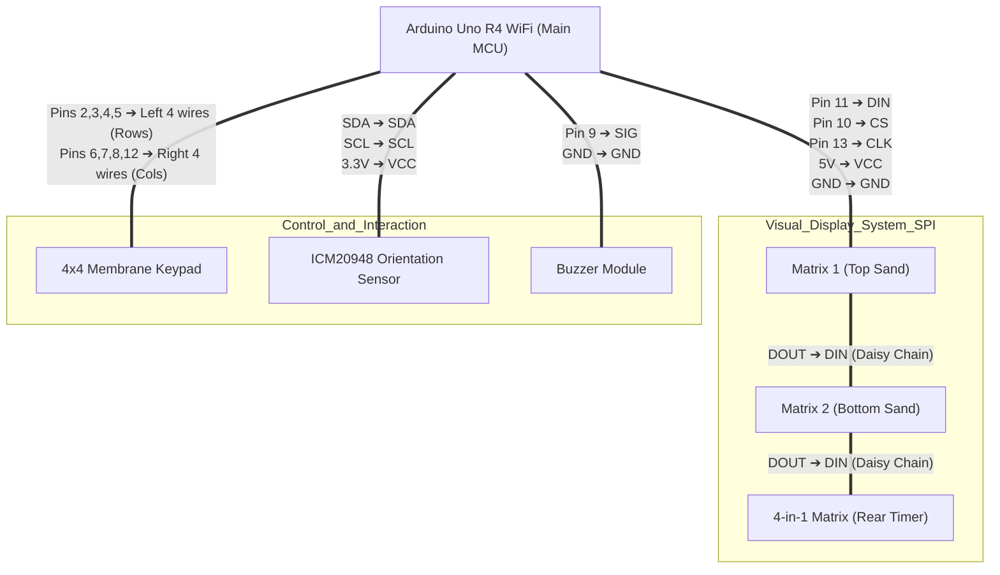

# Digital Hourglass Logical Circuit Diagram

> **Circuit Verification (Verified)**: 
> The latest version integrates a 4x4 matrix keypad. We utilized 8 spare digital pins (2-8, 12) for row/col scanning, completely avoiding the SPI (10-13) and I2C (A4, A5) buses. The system remains 100% free of pin conflicts.

