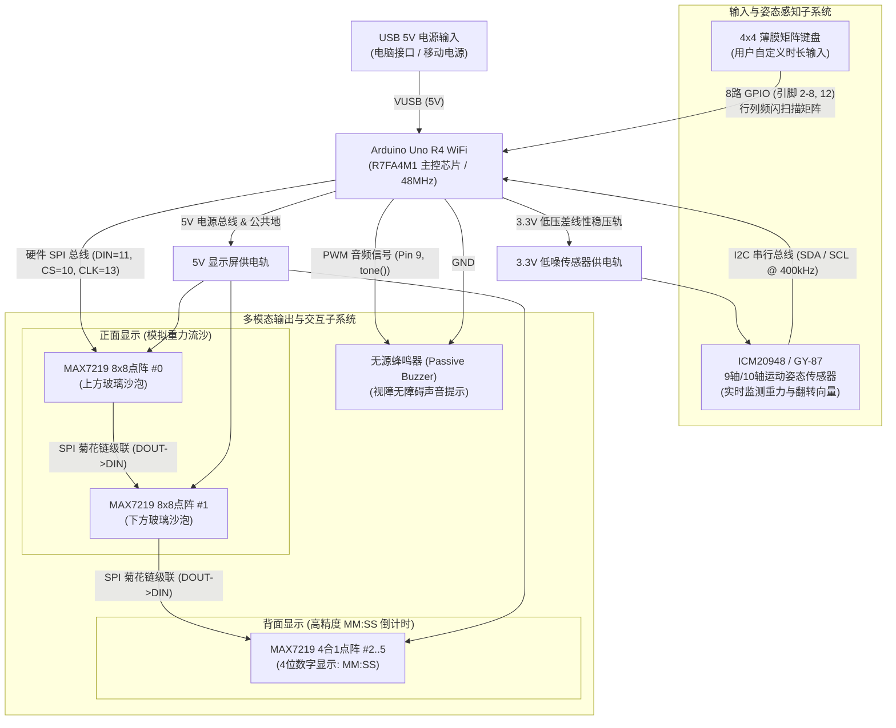
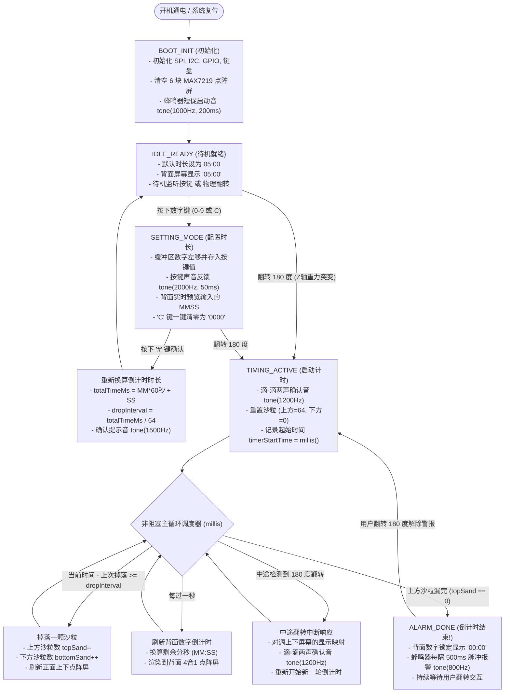

# ELEC281 微挑战：设计阶段与电路图文档 (CDIO 阶段性交付)
**项目：** 具备无障碍交互与双面显示的数字 LED 电子沙漏  
**实验组别 / 盒子编号：** Box 34 | **学年：** 2026–27  
**课程模块：** ELEC281 - Applied Electronic Skills and Engineering Practice  

---

## 1. 硬件高层架构图 (Hardware Flow / Block Diagram)

硬件架构按照系统工程逻辑划分为：**供电系统**、**输入与感知系统**、**主控中枢 (MCU)**，以及**双向输出反馈系统 (视觉+听觉)**。



### 硬件架构设计要点 (Design Highlights)
1. **电源分轨隔离 (Power Rail Isolation)**：MAX7219 点阵屏具有瞬间大电流特性，统一挂接在 Arduino 的 5V 电源总线上；精密惯性传感器 (IMU) 独立使用 3.3V 稳压轨供电，杜绝电压突降造成的传感器通讯死锁。
2. **高速 SPI 菊花链级联 (Daisy Chaining)**：系统共计 6 块 8x8 点阵屏（正面 2 块单屏 + 背面 1 块 4合1 屏），全部通过 SPI 协议的 DOUT $\rightarrow$ DIN 级联。仅耗费 3 根单片机引脚即可统一寻址 384 颗 LED，节约大量 I/O 资源。
3. **独立专用总线**：传感器独占硬件 I2C 总线，键盘使用 8 个通用 GPIO 进行行列快速扫描，彼此无物理与电气冲突。

---

## 2. 软件高层流程图 (Software Flow / State Machine Diagram)

软件架构采用基于非阻塞时间调度 (`millis()` 调度器) 的**有限状态机 (Finite State Machine, FSM)**，确保传感器轮询、按键扫描和沙粒掉落无任何卡顿。



### 软件设计核心优势 (Software Rationale)
* **完全非阻塞设计**：主循环体内彻底废除 `delay()`。按键消抖、蜂鸣器鸣叫和沙粒掉落全部采用时间差计算 (`millis() - previous >= interval`)，保证翻转动作零延迟响应。
* **自适应物理时间换算**：无论用户设定多长时间，代码动态换算单颗沙粒流动时间：
  $$\text{单颗掉落间隔 (dropInterval)} = \frac{\text{用户设定的总毫秒数 (totalTimeMs)}}{64\text{ 颗沙粒}}$$
* **无障碍与盲人友好交互**：开机、按键、确认、翻转和超时警报均配有专有频率的声音信号。

---

## 3. 实现阶段：完整电路接线图 (Circuit Diagram & Pinout)

### 3.1 核心引脚映射表

| 子系统模块 | 外设模块名称 | 模块引脚 | 对应 Arduino Uno R4 引脚 | 功能与电气特性说明 |
| :--- | :--- | :--- | :--- | :--- |
| **电源总线** | 全部 MAX7219 点阵屏 | VCC | **5V** | 驱动 384 颗高亮 LED 峰值电流 |
| | 全部 MAX7219 点阵屏 | GND | **GND** | 统一共地 |
| | ICM20948 / GY-87 传感器 | VCC / 3V3 | **3.3V** | 低噪微弱信号稳压供电 |
| | 姿态传感器 | GND | **GND** | 统一共地 |
| | 蜂鸣器模块 | GND | **GND** | 统一共地 |
| **视觉 SPI 总线** | 屏幕 #0 (正面顶部) | DIN | **Pin 11 (COPI/MOSI)**| 硬件 SPI 高速数据线 |
| | 屏幕 #0 (正面顶部) | CS / LOAD | **Pin 10 (SS)** | 硬件 SPI 片选使能线 |
| | 屏幕 #0 (正面顶部) | CLK | **Pin 13 (SCK)** | 硬件 SPI 同步时钟线 |
| **菊花链级联** | 屏幕 #0 $\rightarrow$ 屏幕 #1 | DOUT $\rightarrow$ DIN | *模块间跳线* | 串行输出传递给第 2 块屏 |
| | 屏幕 #1 $\rightarrow$ 4合1长屏 | DOUT $\rightarrow$ DIN | *模块间跳线* | 串行输出传递给背面 4合1 屏 |
| | 6 块屏幕并联共享 | CS, CLK, VCC, GND | *并联排线* | 共用片选、时钟与供电 |
| **I2C 姿态感知** | 姿态传感器 | SDA | **SDA** (或 A4) | I2C 串行数据线 |
| | 姿态传感器 | SCL | **SCL** (or A5) | I2C 串行时钟线 |
| **听觉交互** | 无源蜂鸣器 | SIG / S | **Pin 9 (PWM)** | 硬件定时器 PWM 音调合成输出 |
| **4x4 矩阵键盘** | 排线第 1 针 (Row 1) | R1 | **Pin 2** | 行扫描输入 (内部上拉) |
| | 排线第 2 针 (Row 2) | R2 | **Pin 3** | 行扫描输入 (内部上拉) |
| | 排线第 3 针 (Row 3) | R3 | **Pin 4** | 行扫描输入 (内部上拉) |
| | 排线第 4 针 (Row 4) | R4 | **Pin 5** | 行扫描输入 (内部上拉) |
| | 排线第 5 针 (Col 1) | C1 | **Pin 6** | 列频闪输出 |
| | 排线第 6 针 (Col 2) | C2 | **Pin 7** | 列频闪输出 |
| | 排线第 7 针 (Col 3) | C3 | **Pin 8** | 列频闪输出 |
| | 排线第 8 针 (Col 4) | C4 | **Pin 12** | 列频闪输出 |

### 3.2 逻辑电路结构图 (ASCII 符号电路图)

```
                     +----------------------------------------------------+
                     |                ARDUINO UNO R4 WIFI                 |
                     |                                                    |
                     |   [5V]  [3.3V]  [GND]   [SDA]  [SCL]   [D9~]       |
                     +----+------+------+-------+------+-------+----------+
                          |      |      |       |      |       |
+-------------------------+      |      |       |      |       |
| (+5V 电源母线)                 |      |       |      |       |
|                                |      |       |      |       |
|   +--------------------+       |      |       |      |       |
|   | ICM20948 / GY-87   |       |      |       |      |       |
|   | 9轴/10轴 姿态传感器|       |      |       |      |       |
|   |                    |       |      |       |      |       |
|   | VCC <--------------+-------+      |       |      |       |
|   | GND <-----------------------------+       |      |       |
|   | SDA <-------------------------------------+      |       |
|   | SCL <--------------------------------------------+       |
|   +--------------------+                                     |
|                                                              |
|   +--------------------+                                     |
|   | 无源蜂鸣器 (Buzzer)|                                     |
|   | SIG <----------------------------------------------------+
|   | GND <-----------------------------+
|   +--------------------+              |
|                                       |
|   +-----------------------------------+--------------------+
|   | 4x4 薄膜矩阵键盘                                       |
|   | 行引脚 (排线 1..4)  =======> D2, D3, D4, D5 (Arduino)   |
|   | 列引脚 (排线 5..8)  =======> D6, D7, D8, D12 (Arduino)  |
|   +--------------------------------------------------------+
|
|   +-----------------------------------------------------------------------------+
|   | SPI 显示屏级联菊花链 (共计 6 块 MAX7219 8x8 点阵屏)                         |
|   |                                                                             |
|   | Arduino: [D11/MOSI] ---------> DIN [屏幕 #0: 正面顶部沙泡]                  |
|   |          [D10/CS]   ---+-----> CS                                           |
|   |          [D13/CLK]  ---+-----> CLK                                          |
|   |          [5V]       ---+-----> VCC                                          |
|   |          [GND]      ---+-----> GND                                          |
|   |                                  | DOUT                                     |
|   |                                  v                                          |
|   |                                 DIN [屏幕 #1: 正面底部沙泡]                 |
|   |                             CS, CLK, VCC, GND 并联共享                      |
|   |                                  | DOUT                                     |
|   |                                  v                                          |
|   |                                 DIN [屏幕 #2..5: 背面 4合1 MM:SS 倒计时屏]  |
|   |                             CS, CLK, VCC, GND 并联共享                      |
+---+-----------------------------------------------------------------------------+
```

---

## 4. 实验课现场答辩与安全核对清单 (Pre-flight Checklist)
* **总线无冲突验证**：SPI（控制屏）、I2C（读取姿态）、PWM（控制声音）、GPIO（键盘）各自占用完全独立的硬件外设，零引脚冲突。
* **防短路规则**：接线前切记**拔掉电脑 USB**；绝不允许将 5V 误接至传感器的 3.3V 端口；杜邦线插好后轻轻扯动确认不松脱。
