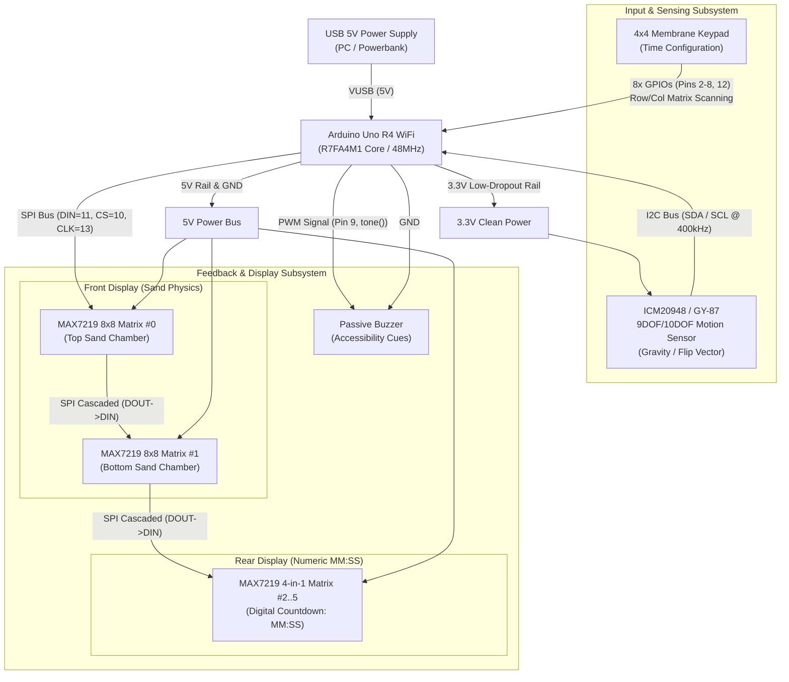
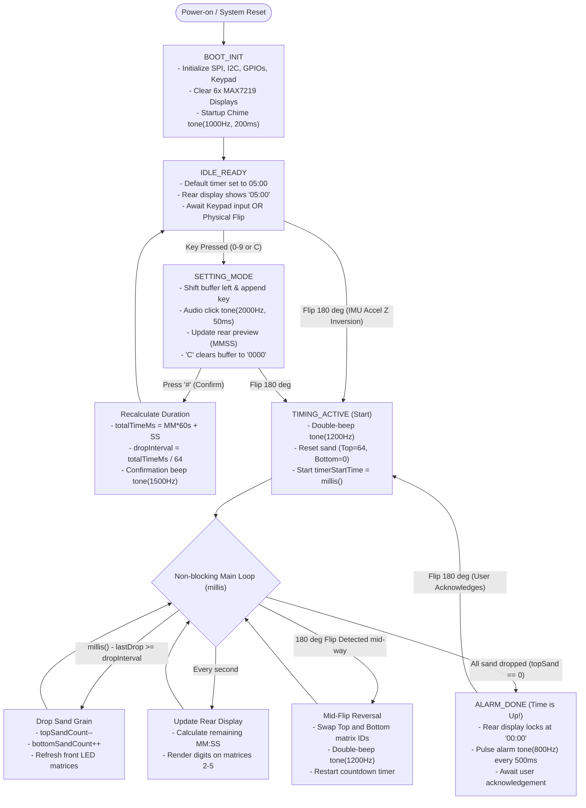

# ELEC281 Mini Challenge: Design Stage & Circuit Documentation
**Project:** Digital LED Hourglass with Accessibility & Dual-Sided Interface  
**Team / Box:** Box 34 | **Academic Year:** 2026–27  
**Module:** ELEC281 - Applied Electronic Skills and Engineering Practice  

---

## 1. High-Level Hardware Flow Diagram (Architecture)

The hardware architecture separates concerns into **Power Supply**, **Input/Sensing**, **Processing (MCU)**, and **Dual Output (Visual + Auditory)** subsystems.



### Hardware Flow Description
1. **Power Domain Separation**: The MAX7219 LED matrices (high dynamic current) are fed from the Arduino 5V rail. The sensitive inertial measurement unit (IMU) is powered from the regulated 3.3V rail to prevent electrical noise and over-voltage damage.
2. **High-Speed SPI Daisy Chaining**: All 6 display units (2 independent chambers + 4 digits) share a single 3-wire SPI interface (`DIN`, `CS`, `CLK`), significantly conserving microcontroller I/O pins.
3. **Dedicated I2C & Matrix GPIOs**: The motion sensor communicates over the standardized I2C bus (`SDA`, `SCL`), while the keypad occupies 8 general-purpose digital pins for fast row-column strobe scanning.

---

## 2. High-Level Software Flow Diagram (Firmware Architecture)

The software is implemented as an event-driven **Finite State Machine (FSM)** with non-blocking timing (`millis()` scheduler), guaranteeing real-time responsiveness to flips and keypad presses.



### Key Software Principles
* **Non-Blocking Architecture**: No `delay()` calls are used inside the active loops. Timer intervals, debounce windows, and buzzer chirps rely entirely on delta-time math (`millis() - previousMillis >= interval`).
* **Dynamic Physics Recalculation**: Changing countdown time dynamically scales the particle drop velocity:
  $$\text{dropInterval} = \frac{\text{totalTimeMs}}{64\text{ LEDs}}$$
* **Inclusive Accessibility Loop**: Audio confirmation accompanies every state change (key click, mode confirm, flip acknowledge, and continuous time-up alarm).

---

## 3. Implementation Circuit Diagram & Pin Specification

### 3.1 Master Interconnection Table

| Subsystem | Peripheral Module | Module Pin | Arduino Uno R4 WiFi Pin | Electrical Characteristics |
| :--- | :--- | :--- | :--- | :--- |
| **Power** | MAX7219 Displays (All) | VCC | **5V** | High current (up to 300mA peak) |
| | MAX7219 Displays (All) | GND | **GND** | System Common Ground |
| | IMU Sensor (ICM20948/GY-87)| VCC / 3V3 | **3.3V** | Regulated low-noise logic supply |
| | IMU Sensor | GND | **GND** | Common Ground |
| | Buzzer Module | GND | **GND** | Common Ground |
| **Visual SPI** | Matrix #0 (Top Sand) | DIN | **Pin 11 (COPI/MOSI)**| High-speed SPI Serial Data |
| | Matrix #0 (Top Sand) | CS / LOAD | **Pin 10 (SS)** | Active-Low Chip Select |
| | Matrix #0 (Top Sand) | CLK | **Pin 13 (SCK)** | SPI Serial Clock |
| **Daisy Chain**| Matrix #0 $\rightarrow$ Matrix #1 | DOUT $\rightarrow$ DIN | *Inter-module jumper* | Cascaded SPI data out |
| | Matrix #1 $\rightarrow$ Matrix #2..5 | DOUT $\rightarrow$ DIN | *Inter-module jumper* | Cascaded SPI data out |
| | All Matrices Shared | CS, CLK, VCC, GND | *Bus Jumper* | Parallel shared control lines |
| **I2C Motion** | IMU Sensor | SDA | **SDA** (or A4) | I2C Data (4.7kΩ internal pullup) |
| | IMU Sensor | SCL | **SCL** (or A5) | I2C Clock |
| **Audio** | Passive Buzzer | SIG / S | **Pin 9 (PWM)** | Square wave frequency synthesis |
| **4x4 Keypad** | Ribbon Pin 1 (Row 1) | R1 | **Pin 2** | Digital Input with Pullup |
| | Ribbon Pin 2 (Row 2) | R2 | **Pin 3** | Digital Input with Pullup |
| | Ribbon Pin 3 (Row 3) | R3 | **Pin 4** | Digital Input with Pullup |
| | Ribbon Pin 4 (Row 4) | R4 | **Pin 5** | Digital Input with Pullup |
| | Ribbon Pin 5 (Col 1) | C1 | **Pin 6** | Strobe Column Output |
| | Ribbon Pin 6 (Col 2) | C2 | **Pin 7** | Strobe Column Output |
| | Ribbon Pin 7 (Col 3) | C3 | **Pin 8** | Strobe Column Output |
| | Ribbon Pin 8 (Col 4) | C4 | **Pin 12** | Strobe Column Output |

### 3.2 Detailed Schematic Representation

```
                     +----------------------------------------------------+
                     |                ARDUINO UNO R4 WIFI                 |
                     |                                                    |
                     |   [5V]  [3.3V]  [GND]   [SDA]  [SCL]   [D9~]       |
                     +----+------+------+-------+------+-------+----------+
                          |      |      |       |      |       |
+-------------------------+      |      |       |      |       |
| (+5V Power Bus)                |      |       |      |       |
|                                |      |       |      |       |
|   +--------------------+       |      |       |      |       |
|   | ICM20948 / GY-87   |       |      |       |      |       |
|   | 9DOF Motion Sensor |       |      |       |      |       |
|   |                    |       |      |       |      |       |
|   | VCC <--------------+-------+      |       |      |       |
|   | GND <-----------------------------+       |      |       |
|   | SDA <-------------------------------------+      |       |
|   | SCL <--------------------------------------------+       |
|   +--------------------+                                     |
|                                                              |
|   +--------------------+                                     |
|   | Passive Buzzer     |                                     |
|   | SIG <----------------------------------------------------+
|   | GND <-----------------------------+
|   +--------------------+              |
|                                       |
|   +-----------------------------------+--------------------+
|   | 4x4 Membrane Keypad                                    |
|   | Rows (Pin 1..4)  =======> D2, D3, D4, D5 (Arduino)     |
|   | Cols (Pin 5..8)  =======> D6, D7, D8, D12 (Arduino)    |
|   +--------------------------------------------------------+
|
|   +-----------------------------------------------------------------------------+
|   | SPI DISPLAY DAISY CHAIN (6x MAX7219 8x8 Matrices)                           |
|   |                                                                             |
|   | Arduino: [D11/MOSI] ---------> DIN [Screen #0: Top Sand]                   |
|   |          [D10/CS]   ---+-----> CS                                           |
|   |          [D13/CLK]  ---+-----> CLK                                          |
|   |          [5V]       ---+-----> VCC                                          |
|   |          [GND]      ---+-----> GND                                          |
|   |                                  | DOUT                                     |
|   |                                  v                                          |
|   |                                 DIN [Screen #1: Bottom Sand]                |
|   |                             CS, CLK, VCC, GND shared                        |
|   |                                  | DOUT                                     |
|   |                                  v                                          |
|   |                                 DIN [Screen #2..5: 4-in-1 Rear MM:SS Timer] |
|   |                             CS, CLK, VCC, GND shared                        |
+---+-----------------------------------------------------------------------------+
```

---

## 4. Key Verification & Safety Checklist for Assessment
1. **No GPIO Bus Contention**:
   * SPI pins (10, 11, 13) are strictly dedicated to high-speed LED shifting.
   * I2C pins (SDA, SCL) are on separate hardware peripheral registers.
   * Keypad scanning uses general digital pins 2-8 and 12, leaving Pin 9 free for hardware timer PWM buzzer generation.
2. **Thermal & Short-Circuit Precaution**:
   * Inspect all DuPont female headers before powering on.
   * Never connect 5V to the IMU sensor 3.3V power pin.
   * Ensure power lines are connected with the USB unplugged.
